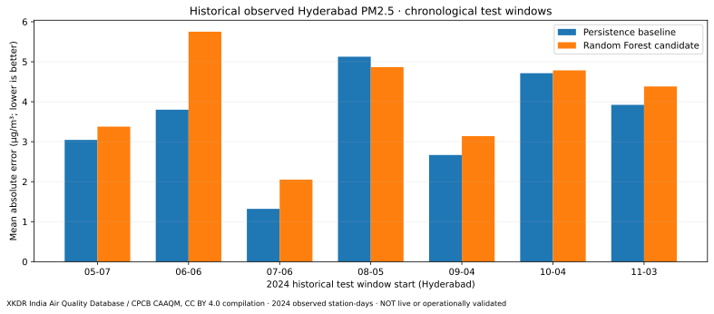

# Observed historical Hyderabad PM2.5 evaluation — 2024

**Verified source-data evaluation (GitHub Actions):** [successful archived run](https://github.com/harshakavali81-collab/AirAware-AI-Air-Pollution-Heat-Risk-Intelligence/actions/runs/40660029536).

This evaluates **historical 2024 Hyderabad observations** supplied by the **XKDR Forum India Air Quality Database**, originally sourced from the **Central Pollution Control Board CAAQM network**. It is **not** live OpenAQ v3 access, a current PM2.5 forecast, a certified model, or citywide exposure guidance.

## Reproducible input and licensing

- Provider: [XKDR India Air Quality Database](https://airquality.xkdr.org/) · [data repository and documentation](https://github.com/xKDR/Air-Quality-Database).
- Source attribution: XKDR Forum, India Air Quality Database and Central Pollution Control Board (CPCB) CAAQM network. Compilation license **CC BY 4.0**; original source notices remain applicable.
- Period: **2024-01-01 to 2024-12-31**, inclusive, Indian local calendar days.
- Provider daily station observations: **5,088 rows**, 15 stations, 366 observed calendar dates; query was **not truncated**.
- PM2.5 unit: **µg/m³** (from upstream unit field), not AQI.
- SHA256 of provider CSV: `52e44b2ac03a979217a137fdab66e3a47f898e061bf88d8ccb5a842d8784a039`.
- Result JSON: [`reports/hyderabad_cpcb_historical_2024.json`](../reports/hyderabad_cpcb_historical_2024.json), including folds, source headers and caveats.
- To reproduce from the published **public demo API key** (rate-limited), execute `python -m scripts.india_cpcb_historical_benchmark --download-xkdr-2024 --output reports/hyderabad_cpcb_historical_2024.json`. The token belongs to XKDR's publicly documented demo tier and is **not** the owner's OpenAQ key.

## Error metrics — one-day-ahead city-average evaluation

| Model | Mean-fold MAE (µg/m³; lower is better) |
|---|---:|
| Previous day persistence baseline | **3.5140** |
| Lagged Random Forest candidate | **4.0506** |

The Random Forest performed worse than persistence by **0.5366 µg/m³ mean-fold MAE**, and was better in only **1 of 7** folds. **Do not deploy this Random Forest as a forecast improvement.** A low city-average error does not prove sensor accuracy, local neighborhood accuracy, or reliable future performance.

## Per-fold results (all errors µg/m³)

| Test window | Persistence MAE | Random Forest MAE | Better |
|---|---:|---:|---|
| 2024-05-07 – 2024-06-05 | 3.0460 | 3.3776 | Persistence |
| 2024-06-06 – 2024-07-05 | 3.8013 | 5.7508 | Persistence |
| 2024-07-06 – 2024-08-04 | 1.3207 | 2.0526 | Persistence |
| 2024-08-05 – 2024-09-03 | 5.1270 | 4.8667 | Random Forest |
| 2024-09-04 – 2024-10-03 | 2.6672 | 3.1405 | Persistence |
| 2024-10-04 – 2024-11-02 | 4.7135 | 4.7839 | Persistence |
| 2024-11-03 – 2024-12-02 | 3.9225 | 4.3821 | Persistence |

## Method and interpretability limits

The workflow uses expanding training windows and seven disjoint 30-day test windows. All features are based on previously available daily aggregates, and a calendar-coverage gate rejects very sparse series. Station-day inputs are averaged to a city time series; **this changes the estimand**. It does not represent PM2.5 at any specific monitor or neighborhood, and site-coverage changes can bias an unweighted aggregate. The per-fold test depends on the previous day's actual observations and is not a 30-day-ahead forecast.

The provider archive is independently downloaded in CI, but individual sensor readings are preliminary and have not been independently calibrated or spatially reviewed by this project. Data were recorded in 2024, not 2026. No public service, live Indian OpenAQ feed, operational forecast or native PBIX has been validated by this benchmark.

For an operational India model: verify independent real-time sensor access, spatial station holdouts, observation QA/calibration, future-season holdouts, drift monitoring, proper uncertainty quantification, and a human-reviewed rollback plan. Never report third-party measurements as official regulatory or personalized health advice.
