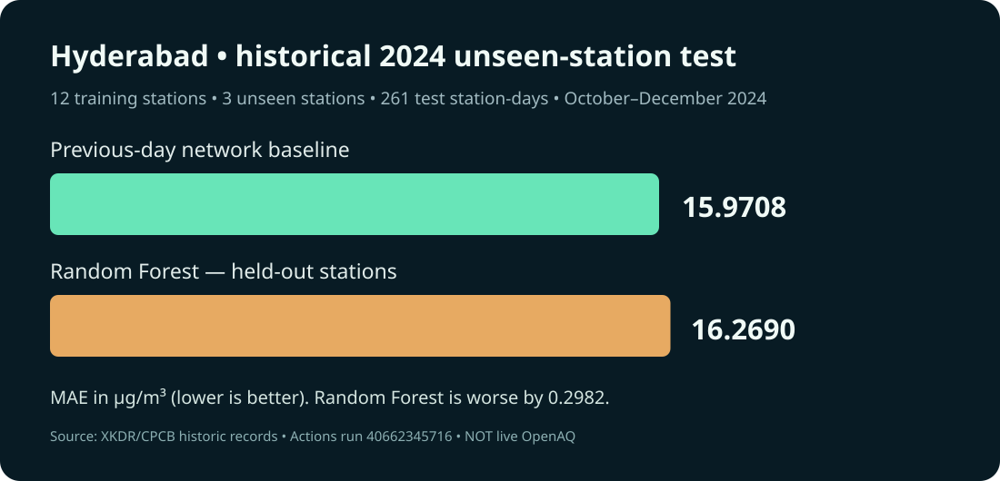

# Recorded-source Hyderabad 2024 spatial and temporal holdout — verified

**Historical observational data, not live OpenAQ or an independently validated operational forecast.** The observed 2024 PM2.5 data were obtained from XKDR Forum's historical CPCB compilation. The [GitHub Actions run](https://github.com/harshakavali81-collab/AirAware-AI-Air-Pollution-Heat-Risk-Intelligence/actions/runs/40662345716) downloaded the data, evaluated unseen Hyderabad stations and finished successfully.

| Test detail | Actual result |
|---|---|
| Training set | 12 stations, earlier than 2024-10-01 |
| Never-trained test sites | 3 distinct stations |
| Evaluation period | 2024-10-01 to 2024-12-31 |
| Test station-day records | 261 |
| Previous-day training-network baseline | **15.9708** MAE; 22.4172 RMSE (µg/m³) |
| Random Forest candidate | **16.2690** MAE; 23.1299 RMSE (µg/m³) |
| Improvement? | **No** — candidate worse by 0.2982 µg/m³ MAE |

The model uses previous-calendar-day mean of only previously known training stations, plus known calendar phase. It trains on **no target readings from held-out stations**. The test-station selection is deterministic by station ID hash among stations meeting a future reporting-coverage threshold (a disclosed potential source of coverage bias).

**Do not compare the absolute MAE directly** with the prior Hyderabad city-average benchmark; this task is station-level generalization at completely unseen locations.

Recorded-source input: 5,088 daily station readings, 15 stations, observed days 366; source CSV SHA-256 `52e44b2ac03a979217a137fdab66e3a47f898e061bf88d8ccb5a842d8784a039`. See [machine-readable full report](../reports/hyderabad_cpcb_spatial_temporal_2024.json) and [methodology](HYDERABAD_SPATIAL_TEMPORAL_VALIDATION.md).

**Unfinished acceptance:** current OpenAQ API authentication, secure full-stack hosting, independent prospectively collected 2026 forecast review and Desktop-verified native Power BI export. A historical backtest does not satisfy them.
