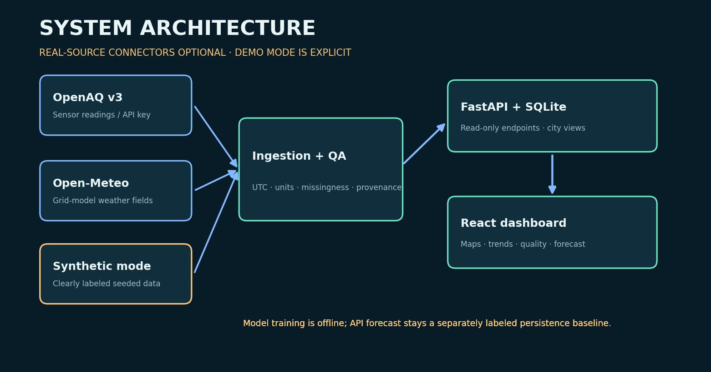
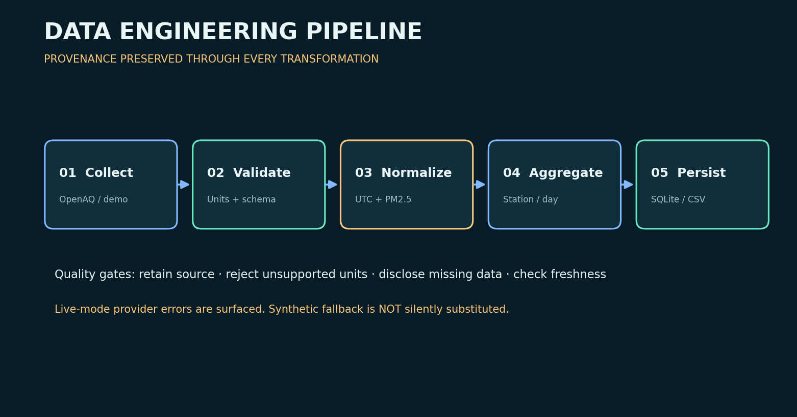
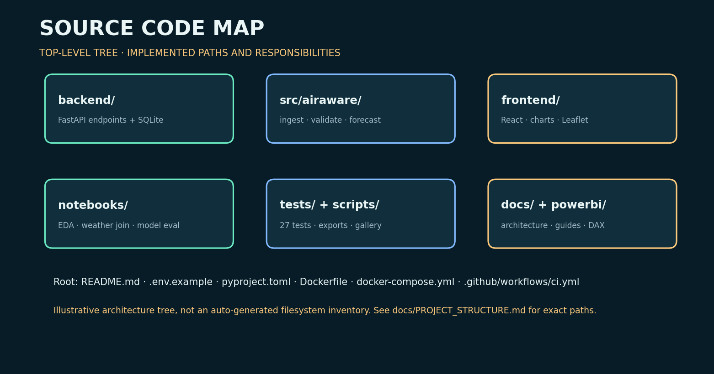
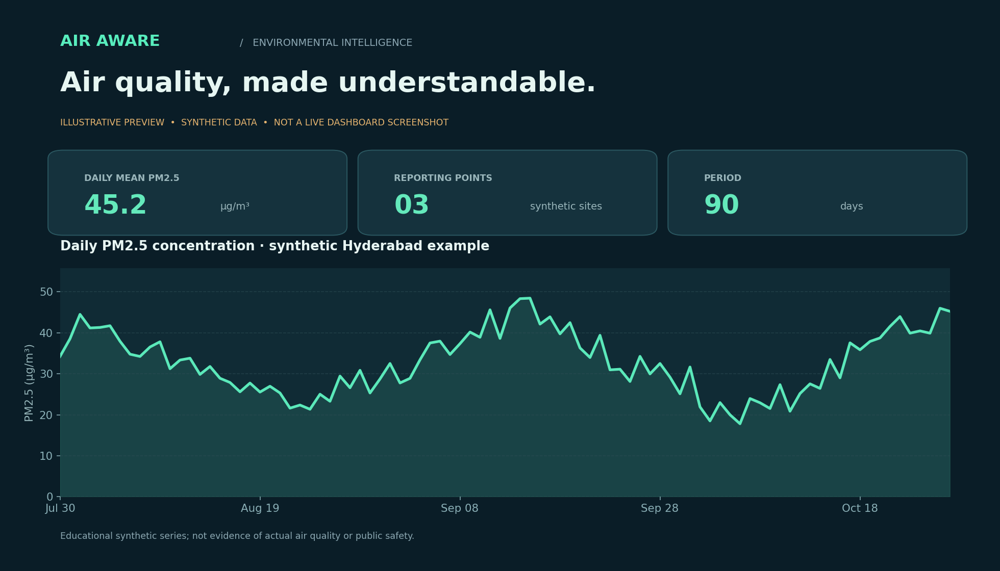
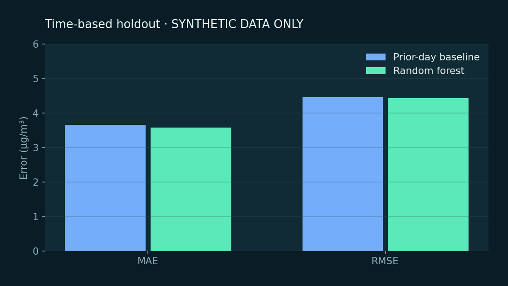
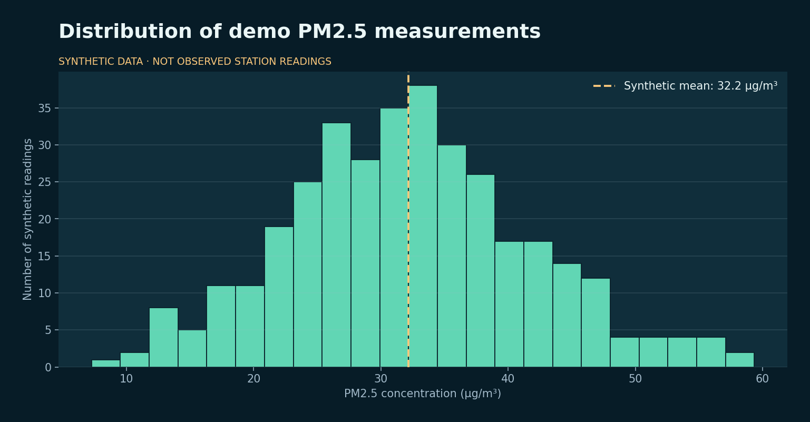
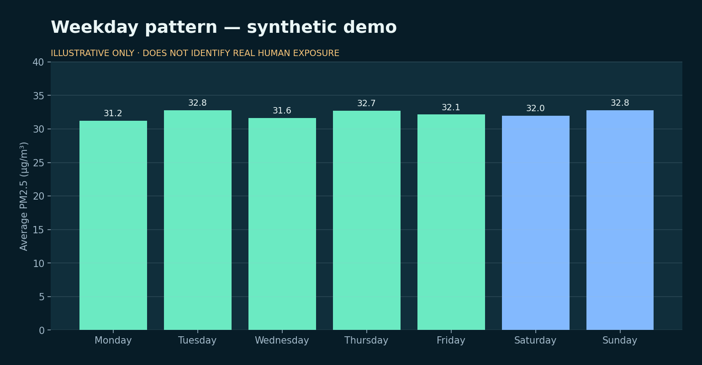
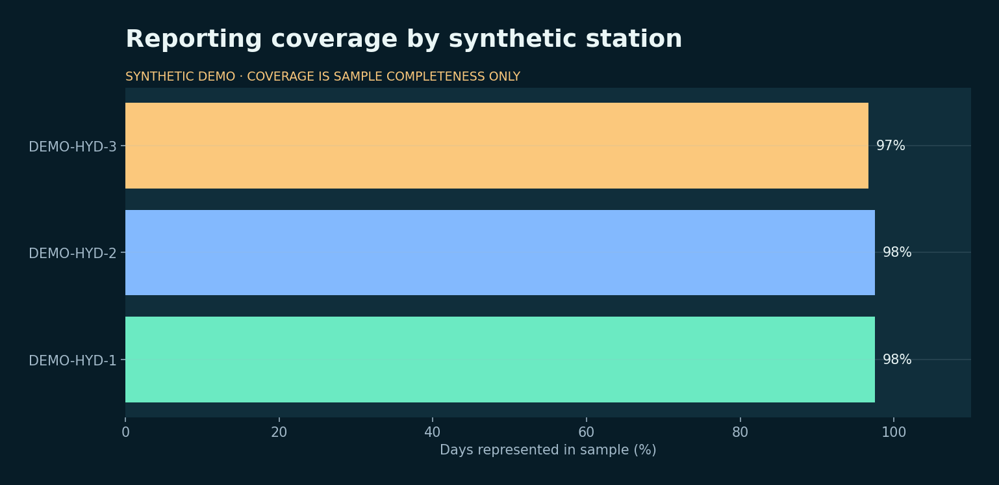

# AirAware AI · Visual Gallery

All original images below are code-generated for this project. **Charts use synthetic PM2.5 observations, not real monitoring data; diagrams illustrate implemented interfaces and are not production infrastructure screenshots.** Reproduce the gallery using `python -m scripts.make_assets && python -m scripts.make_gallery` from the repository root.

| # | Illustration | What it communicates |
|---|---|---|
| 01 | [Dashboard preview](../assets/dashboard-preview.png) | Illustrative 90-day synthetic air quality summary |
| 02 | [Station trends](../assets/station-trends.png) | Synthetic PM2.5 variability by sample station |
| 03 | [Model evaluation](../assets/model-evaluation.png) | Synthetic chronological holdout MAE/RMSE, baseline vs Random Forest |
| 04 | [PM2.5 distribution](../assets/pm25-distribution.png) | Distribution of example concentration readings |
| 05 | [Weekly seasonality](../assets/weekly-seasonality.png) | Educational weekday averages; not an inference about real emission patterns |
| 06 | [Data coverage](../assets/data-coverage.png) | Percentage of expected demo days included for each synthetic station |
| 07 | [System architecture](../assets/system-architecture.png) | Ingest → QA → API → dashboard, with optional live-source connections |
| 08 | [Data pipeline](../assets/data-pipeline.png) | Collect → validate → normalize → aggregate → persist |
| 09 | [End-to-end workflow](../assets/project-workflow.png) | Notebook analysis, model evaluation, deployment gates, documentation |
| 10 | [Project source tree](../assets/project-tree.png) | Directory groups and their responsibilities |

## Engineering visuals

## Analytical charts (synthetic demo)

**Interpretation caveats:** Weekday patterns and distributions are based on algorithmically generated values. Model scores from synthetic holdouts are only unit-test/portfolio examples. Station coverage of 100% in a synthetic demo does not imply real-world station reliability or city coverage.
