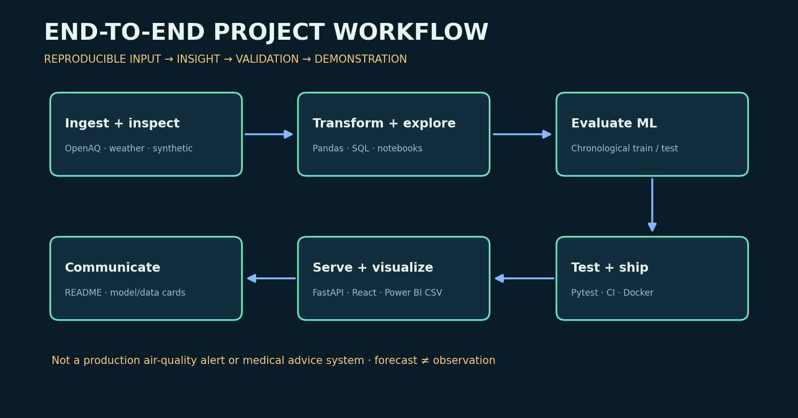
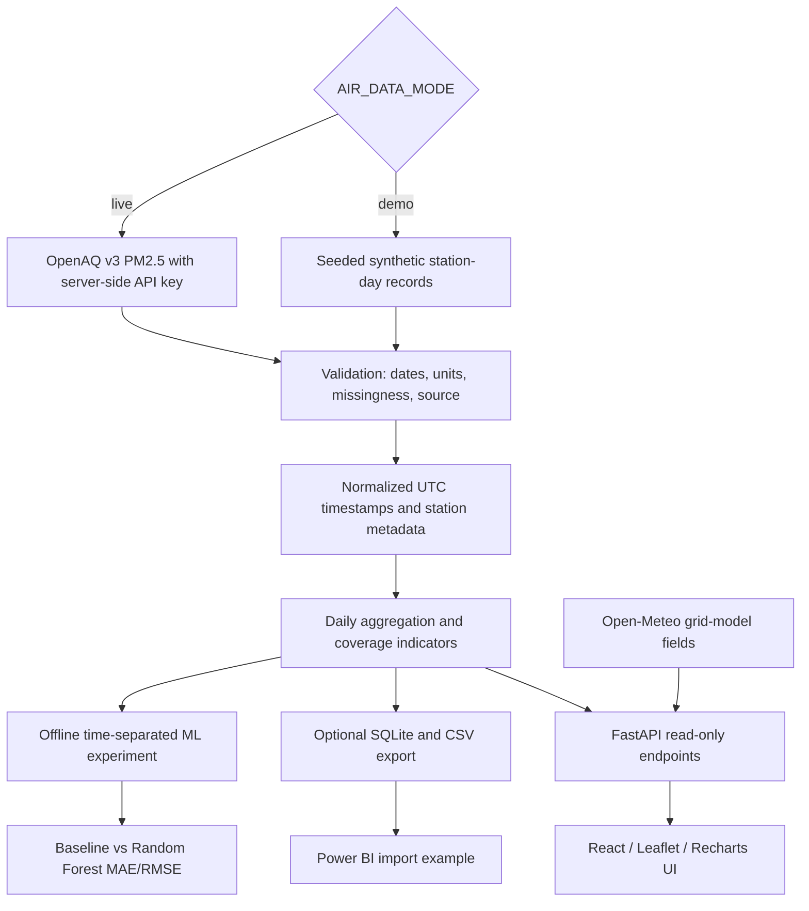
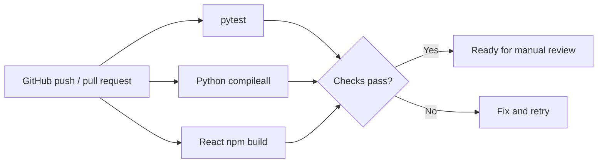

# Project workflow and pipeline

## Data-to-insight flow

`AIR_DATA_MODE=live` is **never** substituted with synthetic measurements on provider failure. Temperature and humidity are contextual model-grid weather fields, not air-quality sensor observations. The public API forecast is a clearly labeled untrained persistence baseline; offline Random Forest evaluation is not silently activated in production.

## Model validation

1. Prepare validated station/day PM2.5 data in µg/m³.
2. Aggregate to the target series without looking at future timestamps.
3. Sort chronologically; train on the first 80%, score on the final 20%.
4. Report MAE and RMSE for both prior-day persistence and Random Forest.
5. Keep the sample benchmark and output model **out** of operational alert decisions.

## CI and release gates

A green CI result does not certify provider connectivity, accessibility, geographic representativeness, ML generalization, production security, or a deployment. No automatic cloud deployment is configured by this repository.
